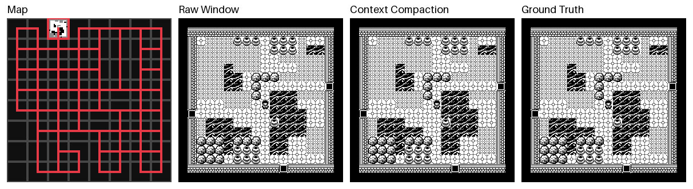

# Context Compaction for World Models



This repository holds the code for our paper Context Compaction for World Models. We release the
weights of our 21 trained world models on Hugging Face in this
[model repository](https://huggingface.co/jadidbourbaki/context-compaction-world-models). Please
see [paper/README.md](paper/README.md) to reproduce our results and [docs/data.md](docs/data.md)
for the format of our recordings.

Note that we use different names for the four designs in the code than in the paper.

- Decoder-only is `per_layer` in the code.
- CED is `ced_full` in the code.
- CED-SWA is `ced` in the code.
- DD is `shared_cache` in the code.

## Setup

Create the environment.

```sh
just setup
```

Download the trained weights.

```sh
just fetch-weights
```

Run the checks and tests.

```sh
just check
```

## Demo

Play the game inside a world model in the browser.

```sh
just play
```

Render the demo above.

```sh
uv run python docs/make_demo.py
```
